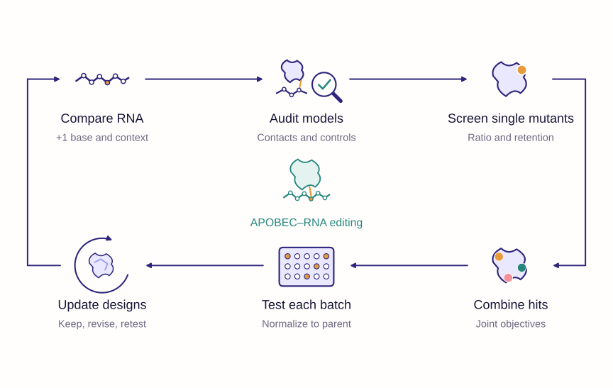

# iGEM Module 3 · APOBEC Dry Lab
The main Wiki text and figures are synchronized from the current [WIKI_SUSTech-BIO Model page source](https://github.com/pdx12320/WIKI_SUSTech-BIO/tree/main/wiki/components/model). See [source and figure checksums](wiki/CURRENT_MODEL_SOURCE.json).


**Structures guide hypotheses; experiments assess preference and activity within each batch.**

This repository organizes the APOBEC module's wiki narrative, ORCA figures, plot-ready data, historical workflow code and exploratory clustering analyses. The English copy follows a Nature-style claim–evidence–boundary structure while retaining an iGEM engineering narrative.

## Two English Markdown documents

1. **[Main wiki](wiki/module3.md)** — Background, Model overview, Results, Conclusion, Data and code availability, and eight primary references. Figure captions are concise; the main narrative contains no DBTL framing.
2. **[DBTL record](wiki/DBTL.md)** — separate design, build, test and learn decisions, with the evidence for each iteration.



The main page uses the supplied ORCA figures **3, 4, 8, N1, 9, 10 and N3**. Figures **7 and N4** remain available as supporting assets; their context is summarized without a separate wiki supplement. The logical workflow is newly drawn with ORCA colours and typography, with editable SVG text/arrows, a disclosed conceptual image asset, PNG and PDF exports. It does not require PowerPoint.

## Data and code

| Directory | Contents |
|---|---|
| `wiki/` | English main wiki, separate DBTL record and selected figure assets |
| `data/` | Plot tables, selected evidence tables and original source manifests |
| `figure-sources/` | Supplied ORCA plotting scripts, input snapshots and original figure exports |
| `code/historical/` | Supplied 88 Python and two shell scripts, organized by analysis stage |
| `scripts/` | New numerical audit, workflow drawing and ESM-2 comparison |
| `analysis/cp-clustering/` | Frozen contact-probability clustering study, scripts and results |
| `analysis/esm2/` | New 11-construct comparison, frozen plan, embeddings, distances and report |
| `provenance/` | Input hashes, documented path edits and executed validation reports |

Large original structure and sequencing archives are distributed through the **[data release](https://github.com/pdx12320/igem_module3/releases/tag/module3-data-v1)** rather than ordinary Git objects. See [data access and checksums](data/README.md).

## Main evidence boundaries

K30H reaches a +1 ratio of 1.71 with 0.84 activity retention in the single-mutant screen. G27T–K30H–Q58M reaches 2.156 with 0.773 retention in a separate combination batch. These are batch-specific observations, not a controlled cross-batch improvement estimate.

The executed CP audit reproduces the selected structural partition and checks 6,400 stored bootstrap records. The new ESM-2 comparison produces representation-dependent groups and does not separate T31A from T31D. Both clustering studies are therefore supporting analyses; neither is presented as a validated predictor of editing activity.

## Reproduce the lightweight checks

Use an existing compatible environment or an isolated environment; do not modify a base environment. Versions used for the numerical audit are in [requirements-audit.txt](requirements-audit.txt).

```bash
OPENBLAS_NUM_THREADS=1 OMP_NUM_THREADS=1 \
python scripts/audit_science.py --output work/science-audit.json
```

The report refuses to overwrite an existing file. [Code entry points](code/README.md) explain the separate plotting, ESM-2 and historical workflows. No new AF3 inference, wet-lab experiment or complete sequencing reanalysis was performed for this repository.

## Provenance and reuse

Input data were preserved. Selected ORCA data figures retain their original numerical values and byte-identical image exports. Redundant HTML reports and indexes are omitted; source Markdown reports and original input archives remain traceable. Published copies remove machine-specific private paths where documented. Historical drafts and full source captions remain in the source packages for provenance. Concise publication captions in `wiki/figures/` match the revised main narrative; caption edits are recorded separately.

The existing repository MIT license is retained for code. Source data, figures and third-party model weights retain their respective provenance and applicable rights; the repository license does not imply ownership of externally sourced material. ESM-2 weights are not redistributed.
