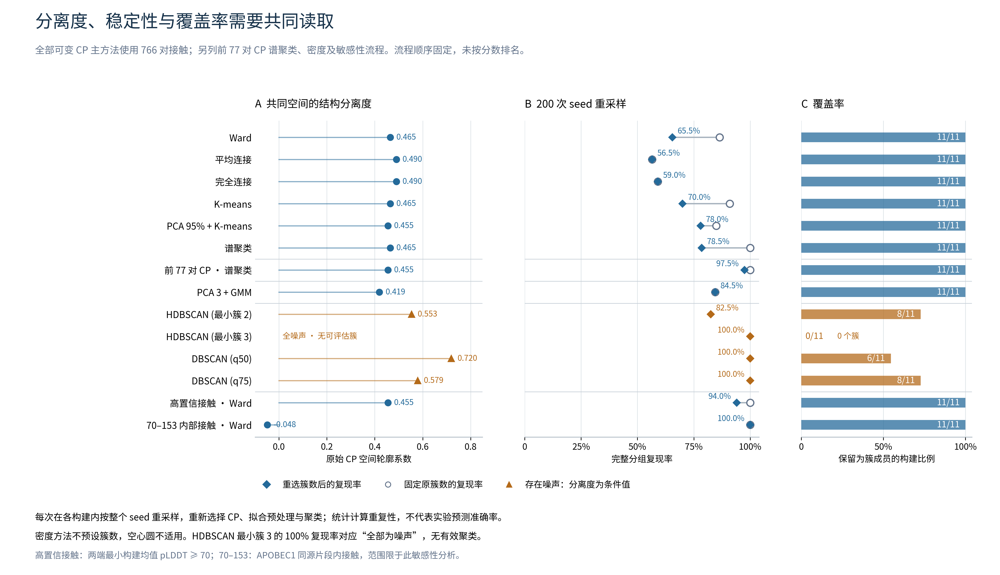
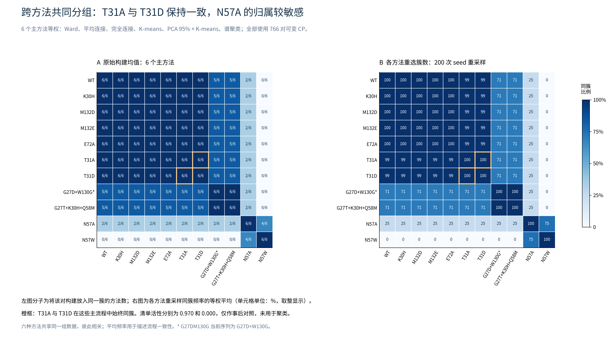

# 按 GitHub skills 重跑 CP 聚类流程

2026-09-15｜11 构建 / 56 seed / 280 预测结构｜32 个非 UMAP 配置＋2 个 UMAP 基线流程

已安装并应用 K-Dense 的 scikit-learn、umap-learn、statistical-analysis。多流程比较支持保留可解释的 CP 结构分支：前 77 对高方差 CP＋谱聚类的三组结果较易复现；置信度过滤＋Ward 给出同样三组。UMAP 的额外分组未改善原 CP 空间的分离或活性对应。候选残基中，N74 / L33 的跨分组支持最一致。

## 1. 下载并采用的 skills

| Skill | 上游版本 | 本轮采用部分 |
| --- | --- | --- |
| scikit-learn | 1.3 | 多算法比较、PCA、silhouette / CH / DB、参数与预处理记录 |
| umap-learn | 1.3 | 5D UMAP→KMeans/HDBSCAN，邻域与随机种子敏感性 |
| statistical-analysis | 1.2 | 明确样本单位、保留缺失/无结果、效应解释与探索性边界 |

[scikit-learn：GitHub 固定版本源码](https://github.com/K-Dense-AI/scientific-agent-skills/tree/330c8e764435a731eff571e3efdda70b363d0792/skills/scikit-learn)

[umap-learn：GitHub 固定版本源码](https://github.com/K-Dense-AI/scientific-agent-skills/tree/330c8e764435a731eff571e3efdda70b363d0792/skills/umap-learn)

[statistical-analysis：GitHub 固定版本源码](https://github.com/K-Dense-AI/scientific-agent-skills/tree/330c8e764435a731eff571e3efdda70b363d0792/skills/statistical-analysis)

固定上游 commit：330c8e764435a731eff571e3efdda70b363d0792。源文件 SHA256、安装版本及安装页见 skills_provenance.json。scikit-learn 的 compatibility 字段按环境要求移入 metadata，正文与脚本保持原文。

本轮代码依据 skill 的 clustering_analysis.py 与相关指南改写，并针对数据规模作了适配：常规 k 从示例 2–10 缩为 2–4；CP 保留相同概率单位；逐 CP z-score 单独报告；密度聚类即使只有单簇或全噪声也保留；GMM 固定为 PCA3＋球形协方差；不屏蔽数值警告。技能引用已列入本报告末尾。

## 2. 分析设计与输入

沿用上一轮从原始 ZIP 提取的 contact_probs。对每个 seed 的 5 个样本平均并对称化，再对同一构建内 seed 等权平均。11 个构建是分析单位，280 个预测模型没有当作 280 个独立生物样本。输入仍为 |i−j|≥4 的 19,110 对唯一非局部 CP，其中 766 对在构建均值之间有变化。

6 条主算法路线各自比较全部 766 对可变 CP，以及方差最高的 77、154、230 对，形成 24 个组合；另加 GMM、两种 HDBSCAN、两种 DBSCAN、标准化、置信度过滤、APOBEC1 来源核心内部 CP，共 32 个配置。每个配置都做 200 次构建内整 seed bootstrap，重新筛选特征、拟合变换和聚类。置信度阈值的掩码在基线固定。

常规 k 按其输入空间 silhouette 选择；PCA＋KMeans 在 PCA 空间选择；谱聚类以所选 CP 空间评价；GMM 在同一 PCA3 输入中按 BIC 选 1–4 类。所有方案另计算共同的原始 CP 空间 silhouette，方便检查变换是否扭曲分组。UMAP 的 k 直接按原始 CP 空间 silhouette 选择。活性从未用于上述选择。

同时报告两种稳定性：①重新选择 k 后完全复现整个基线分组；②固定基线 k 后复现。前者把类数不确定性一起计算。本轮使用 200 次、随机种子 20260915；上轮 500 次且主要报告固定 k，两轮百分比的差异不能直接当作模型改进。

## 3. 哪些流程更适合这批结构

| 流程 | 输入 CP 数 | 类数 | 共同原 CP silhouette | 重选 k 分组复现 | 固定 k 分组复现 |
| --- | --- | --- | --- | --- | --- |
| 全部可变 CP→Ward | 766 | 2 | 0.465 | 65.5% | 86.5% |
| 全部可变 CP→average | 766 | 2 | 0.490 | 56.5% | 56.5% |
| 全部可变 CP→KMeans | 766 | 2 | 0.465 | 70.0% | 91.0% |
| PCA保留≥95%方差→KMeans | 766 | 3 | 0.455 | 78.0% | 85.0% |
| 全部可变 CP→谱聚类 | 766 | 2 | 0.465 | 78.5% | 100.0% |
| 前77对高方差 CP→谱聚类 | 77 | 3 | 0.455 | 97.5% | 100.0% |
| 置信度≥70 CP→Ward | 411 | 3 | 0.455 | 94.0% | 100.0% |
| 5D UMAP→KMeans | 766 | 4 | 0.257 | 46.0%（100次） | 未单独固定 k |
| 5D UMAP→HDBSCAN | 766 | 4 | 0.257 | 32.0%（100次） | 未单独固定 k |

前 77 对 CP＋谱聚类在 200 次重复中有 195 次（97.5%）复现同样三组，固定三类时为 100%。核宽度由所选 CP 距离中位数决定，采用完整 RBF 相似度矩阵与 cluster_qr 分配。它可作为本批结构分组的紧凑主流程；该高复现率仍只对应当前构建及计算 seed。

置信度过滤保留两个端点的最低构建均值 Cα pLDDT 都 ≥70 的接触，共 411 对可变 CP。Ward 得到相同三组，重选类数复现率 94%，固定三类为 100%。可将它作为对低置信区域影响的独立处理方式。

| 结构组 | 构建 |
| --- | --- |
| 1 | WT、E72A、K30H、M132D、M132E、T31A、T31D |
| 2 | G27D+W130G、G27T+K30H+Q58M |
| 3 | N57A、N57W |

全部可变 CP 的 average / complete 在基线得到同一分区：N57W 单独一组，其余 10 个构建一组。其 silhouette≈0.490 较高，但包含单成员组且重采样稳定性一般。PCA95 实际保留 5 个主成分、97.13% 方差，得到三组；PCA 内 silhouette=0.526，共同原 CP 为 0.455。

## 4. UMAP 和密度聚类揭示了什么

UMAP 设为 5 维、min_dist=0、n_neighbors=3/5/8，各跑 20 个随机种子，共 60 次嵌入。基线使用 n_neighbors=5、random_state=20260915，再做 100 次整 seed bootstrap。每次都运行 KMeans 和 HDBSCAN，累计 320 个算法结果。

基线两种 UMAP 后续聚类都得到四组：WT/M132D/M132E；E72A/K30H/N57A/N57W；两个 G27 组合；T31A/T31D。嵌入空间 silhouette=0.412，但原 CP 空间仅 0.257；完全复现率分别为 46% 和 32%。邻域与随机状态变化会切出不同小组，本批数据没有显示 UMAP 带来更可靠的结构或活性分组。

[UMAP 官方文档：密度保持与人为分裂的限制](https://umap-learn.readthedocs.io/en/latest/clustering.html)

| 补充配置 | 类数 | 被分组构建/11 | 单成员簇 | 原 CP silhouette | 完整状态复现率 |
| --- | --- | --- | --- | --- | --- |
| variable_all__gmm_pca3 | 4 | 11 | 2 | 0.419 | 84.5% |
| variable_all__hdbscan2 | 3 | 8 | 0 | 0.553 | 82.5% |
| variable_all__hdbscan3 | 0 | 0 | 0 | 不可计算 | 100.0% |
| variable_all__dbscan_q50 | 2 | 6 | 0 | 0.720 | 100.0% |
| variable_all__dbscan_q75 | 2 | 8 | 0 | 0.579 | 100.0% |
| zscore_variable__ward | 2 | 11 | 0 | 0.465 | 100.0% |
| core70_153__ward | 2 | 11 | 1 | -0.048 | 100.0% |

HDBSCAN(min_cluster_size=2) 保留 8/11 个构建，分为 WT/K30H/M132D/M132E、两个 G27 组合、T31A/T31D；E72A、N57A、N57W 标为噪声。min_cluster_size=3 时全部 11 个构建始终为噪声，因此 100% 状态复现不代表找到了有效的稳定簇。

DBSCAN q50 的 silhouette=0.720 仅在 6/11 个被分组构建上计算，另外 5 个包括 T31A/T31D 都被排为噪声。q75 保留 8/11。去噪后的分数不能与覆盖全部 11 个构建的分数直接排优劣。GMM 的 4 类包含 N57A、N57W 两个单成员组；该结果保留为探索性描述。

逐 CP z-score→Ward 的两组在此轮 200 次重复中全部复现，但标准化会放大微小 CP 变化的相对权重。本轮因此保留它作敏感性对照，没有用这个百分比替代概率刻度下的主分析。

## 5. 催化核心分析与候选残基的更新

只使用 70–153 位两个端点都在 APOBEC1 来源核心的 CP，得到 108 对可变接触。Ward 稳定把 E72A 单独分出；核心内部 silhouette=0.570，映射回全 CP 为 −0.048。它揭示了局部核心响应，对整体结构分组的描述能力有限。该限制还会删掉 L33–N74、Q58–N74 等跨区域接触，因此关键位点筛选应保留这类接触信息。

进一步计算每个分区在原 CP 空间的簇间平方和 BCSS，再将涉及同一残基的接触分数相加。6 个主算法只有 3 种唯一分区，故按 3 种分区等权汇总，避免重复算法放大一致性。该分数描述哪些 CP 支持结构分组；它与此前“总方差热点”回答的问题不同。没有用 ANOVA 显著性或活性标签给位点排名。

| 残基 | 此前方差排名 | 唯一分区等权BCSS排名 | 3种分区前20覆盖 | 留一构建方差排名范围 | 解释 |
| --- | --- | --- | --- | --- | --- |
| N74 | 6 | 5 | 3/3 | 4–11 | 三种唯一主分区均进入前20；描述结构分组差异 |
| L33 | 11 | 12 | 3/3 | 11–14 | 三种唯一主分区均进入前20；描述结构分组差异 |
| Y32 | 15 | 16 | 2/3 | 4–23 | 进入前20依赖于分组；保留局部接触或机制依据 |
| N23 | 2 | 7 | 1/3 | 2–7 | 进入前20依赖于分组；保留局部接触或机制依据 |
| R28 | 18 | 25 | 1/3 | 5–28 | 进入前20依赖于分组；保留局部接触或机制依据 |
| W99 | 20 | 26 | 1/3 | 8–31 | 进入前20依赖于分组；保留局部接触或机制依据 |
| F129 | 21 | 56 | 0/3 | 10–38 | 主分区BCSS前20未覆盖；依据原局部接触/催化注释单独评估 |

N74、L33 在三种唯一主分区均进入前 20，跨高方差比例也较一致，适合优先构建新增位点验证。Y32 保留为识别邻域候选。N23 的高方差在留一构建后仍明显，但其对聚类的贡献主要来自单列 G27 组合的三组方案；R28/W99 同样具有分区依赖。

F129 的 BCSS 排名下降到 56，说明它对当前主要结构分支的区分贡献有限。T31–F129 仍保留为局部机制线索：上一轮 T31A 的 CP 为 0.4550、T31D 为 0.1875，湿实验活性分别为 0.970、0.000。两者在整体分组中始终靠近，正好说明局部差异和全局分组需要分别解读。尚无 F129 替换的因果验证。

G68/F66/N61 等高 BCSS 位点在部分构建的局部置信度低，表格保留提示。H70/E72/C102/C105 仍作为同源映射的催化机制对照。这里没有给出有利替换方向或新构建活性预测。仅核心内部 CP 的表示中，N74 排名降至 46，故“稳定”限定在保留跨区域接触的主流程。

## 6. 与活性清单对照后，结论是否改变

34 条基线流程中，32 条将 T31A/T31D 放在同簇，另外 2 条至少有一者为噪声/未分组；没有流程将两者可靠分到不同的有效簇。UMAP 的 60 次参数/随机运行和 100 次 seed 重采样，两种后续算法均始终将这对构建放在同簇。

仍保留原表数值与缺失：WT/N57A/E72A 的活性为空；G27DM130G 的实际结构为 G27D+W130G，其 0.000 暂不作可靠的结构对应标签。有效数字标签只有 7 个构建。活性没有单位、WT 归一化方法或三个 C 的逐位点列，因此本轮不输出编辑效率百分比或 work 分类准确率。

| 实际构建 | 原表活性 | 前77对CP＋谱聚类组 | 置信度过滤＋Ward组 | 结构对应 |
| --- | --- | --- | --- | --- |
| WT | 缺失 | 1 | 1 | 一致 |
| M132D | 0.890 | 1 | 1 | 一致 |
| M132E | 0.830 | 1 | 1 | 一致 |
| K30H | 0.840 | 1 | 1 | 一致 |
| G27T+K30H+Q58M | 0.770 | 2 | 2 | 一致 |
| T31D | 0.000 | 1 | 1 | 一致 |
| N57W | 0.000 | 3 | 3 | 一致 |
| G27D+W130G | 0.000 | 2 | 2 | 命名与序列不符，活性不纳入定量对应 |
| T31A | 0.970 | 1 | 1 | 一致 |
| N57A | 缺失 | 3 | 3 | 一致 |
| E72A | 缺失 | 1 | 1 | 一致 |

建议后续汇报采用“前 77 对高方差 CP＋谱聚类”展示三条结构分支，同时给出“置信度过滤＋Ward”和原始 CP Ward 的对照。位点层面优先保留 N74/L33，并将 F129 作为 T31A/D 局部机制验证候选。当前选择依据为本批结构分组的简洁性、可解释性与计算复现；实验有效性仍需新增构建验证。

## 7. 复现与方法来源

代码、输入数组、全部 6,400 条主流程 bootstrap、320 条 UMAP 算法结果、簇数扫描、置信度与区域筛选定义、残基一致性、11 次留一构建敏感性、完整警告日志和软件版本均纳入 ZIP。数值审核独立重算了共同 CP silhouette、ARI、分组复现率与共聚矩阵，并检查了输入聚合。

UMAP 0.5.12 在独立环境真实运行；自动解析的较新 numba 曾在导入时失败，固定 numba 0.63.1 / llvmlite 0.46.0 后完成全部计算。依赖版本记录在 umap_requirements.txt，未将依赖环境或大型运行缓存打包。

[scikit-learn：聚类方法与指标官方说明](https://scikit-learn.org/stable/modules/clustering.html)

[Kassis, T., Agarwal, V., He, Y., Patel, D., & Brueckner, A. M. (2026). Scientific Agent Skills: A Library of Procedural Knowledge for Research Agents.](https://doi.org/10.48550/arXiv.2609.00065)

上述 skill 论文介绍分析流程知识库，没有给出任务层面的效果验证。本次是否有用由本批 CP 的实际运行结果评价，安装 skill 本身不构成模型效果证据。
