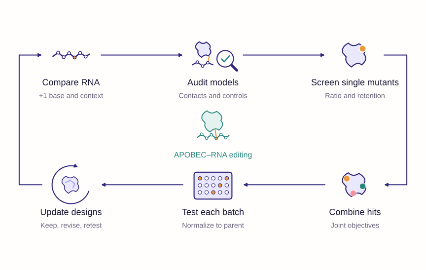
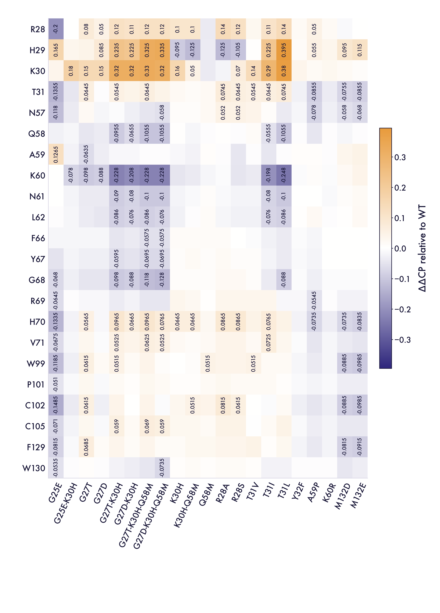
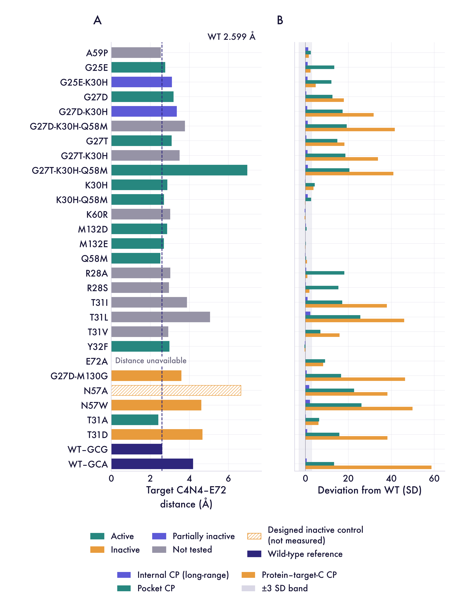
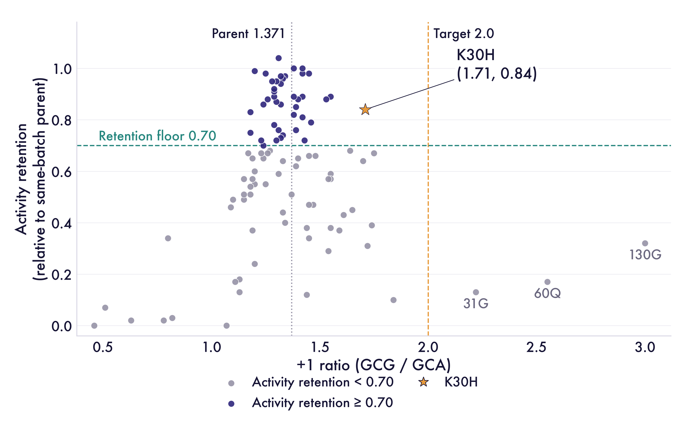
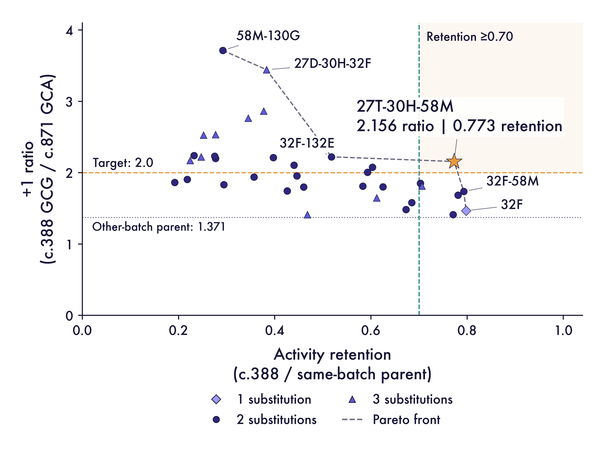
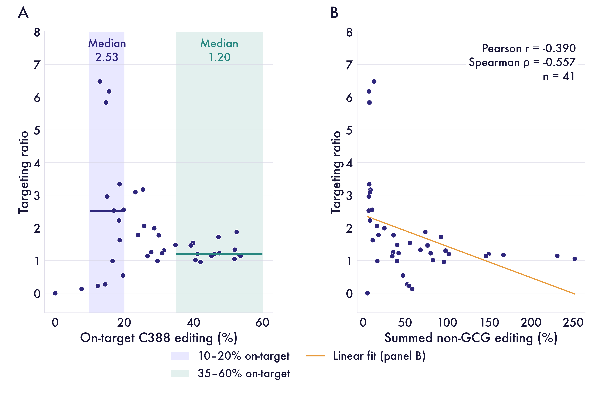
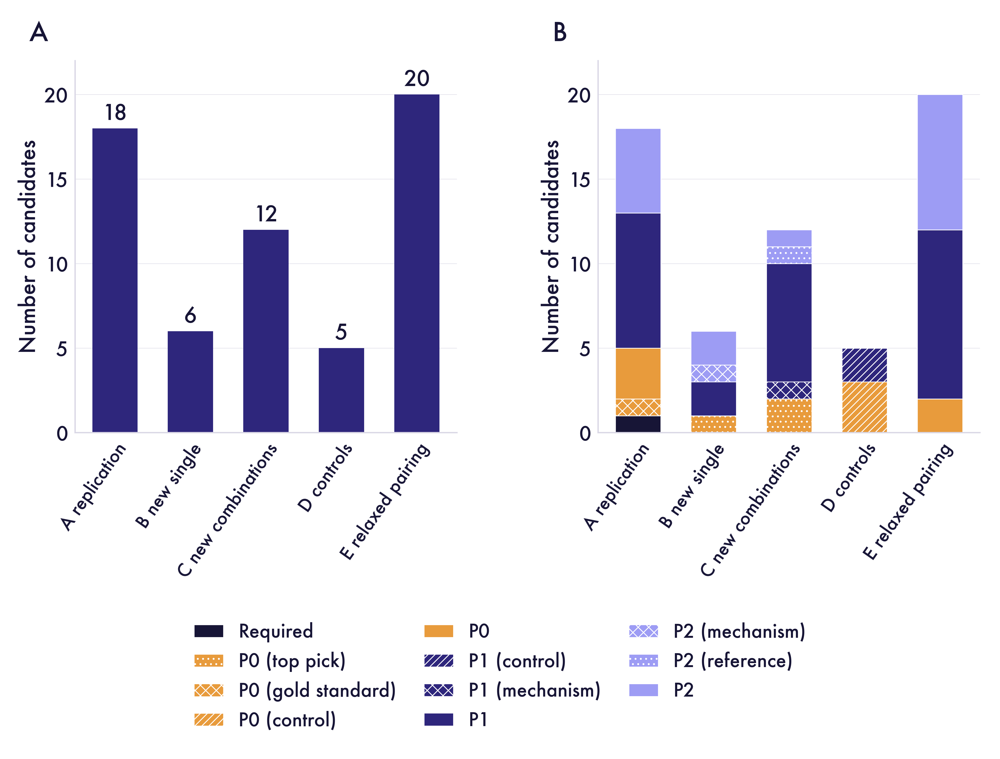
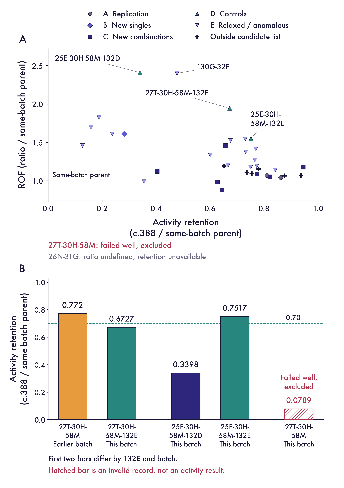

# Module 3: APOBEC Engineering

## 3.1 Overview

The APOBEC combination screen identified a lead that met both substrate-preference and retained-activity criteria in the same batch. Programmable RNA editing can alter a transcript without changing its genomic sequence. Pumilio/FBF (PUF) proteins offer a modular route to RNA recognition (Wang et al., 2002), with engineered repeats extending recognition to cytosine (Filipovska et al., 2011). Engineered PUF–APOBEC fusions have enabled targeted C-to-U editing in cells and animals (Han et al., 2022; Han et al., 2025). These systems provide a starting point for improving the balance between editing activity and substrate preference.

RNA recognition and cytosine selectivity are complementary parts of editor design. APOBEC1 structure–function studies distinguish features involved in RNA and DNA substrate recognition, while APOBEC-containing DNA editors show substantial unintended RNA editing (Wolfe et al., 2020; Grünewald et al., 2019). These findings motivate measuring the distribution of editing after recruitment to the target RNA.

Deaminase engineering can change sequence-context compatibility. Directed evolution has expanded APOBEC1-based DNA editing in GC contexts, and later work produced TadA-derived enzymes with different preferences for bases flanking the target cytosine (Thuronyi et al., 2019; Wu et al., 2026). These studies provide precedents for measuring context preference as an engineering objective. Here, we test that objective in an RNA reporter assay.

Here, we examined the 199-residue Pro.hA1 scaffold used in our PUF-directed APOE4 editing system. Our main comparison was between c.388 in a GCG context and c.871 in a GCA context. Both sites share G at the −1 position but differ at +1. Reporter signal at c.295 in an ACA context provided a complementary readout. We asked whether structural analysis could guide substitutions that favour the intended site while retaining useful activity.

This work complements PUF design by examining the catalytic component after RNA recognition. Predicted protein–RNA contacts organize substitution hypotheses, and within-batch measurements assess the **balance between substrate preference and retained reporter signal**.

We summarize the model–experiment development as **three main rounds**: structure-guided single-mutant screening, assay-informed combination design, and follow-up refinement across sequence backgrounds. Each round connected a design question with measured substrate preference and retained activity. Experimental feedback then shaped the next candidate set or comparison, carrying the work from individual substitutions to combinations and subsequent testing.

## 3.2 Modeling approach

### Structural representation

We used AlphaFold 3 to model protein–RNA interactions across substrates and variants (Abramson et al., 2024). Predicted interface contacts supplied structural hypotheses for the subsequent activity–preference screen.

The RNA inputs were **GUGCGCG**, **GUGCACG** and **AUGCAGC**. The first two isolate a +1-base substitution in a shared local sequence; the third changes the broader flanking context. The baseline modelling plan used 20 computational seeds and five predicted models per seed for each substrate.

We used two complementary contact descriptions. **Coordinate-based contact decomposition** distinguished side-chain and backbone contacts with RNA bases or the sugar–phosphate backbone. Contact probability (**CP**) came from the AF3 `contact_probs` matrices, averaged across available predictions. We interpreted CP alongside the frequency of geometric contacts across structures.

These two contact descriptions address different aspects of the predicted protein–RNA interface. Geometric contact frequency records how often a contact appears across structures, whereas CP summarizes the model's predicted contact probabilities. Separating base contacts from backbone contacts helps locate changes within the interface. Neither description measures catalytic turnover or the fraction of RNA molecules edited in the reporter assay.

For residue contacts with the +1 RNA nucleotide, we defined:

- **ΔCP = CP(GCA) − CP(GCG)**
- **ΔΔCP = ΔCP(mutant) − ΔCP(parent)**

Positive ΔΔCP indicates a relative shift towards A-associated contact; the reporter assay measures preference for the intended GCG site.

The direction of a contact change therefore needs an experimental interpretation. A shift towards A-associated contact does not directly predict improved editing at the intended GCG site. Likewise, closely similar predicted structures can still accompany markedly different reporter activities. The structural comparison supplies testable substitution hypotheses, while the reporter measurements determine whether those substitutions improve the engineering outcome.

Matched GCG/GCA comparisons isolate the +1 base; mutant–parent differences guide substitutions for **joint measurement of preference and retained activity**.

**Figure 25.** Structural modelling and experimental screening workflow. The central protein–RNA image is conceptual.

### Experimental readouts

Preference and activity were evaluated together, **using the parent from the same experimental batch**.

Previous DNA-editor studies used deaminase mutagenesis to reduce unwanted RNA editing while retaining on-target DNA editing (Zhou et al., 2019; Grünewald et al., 2019). This provides a precedent for evaluating desired and undesired activity together. Our goal requires a different balance: retaining intended RNA editing while measuring its distribution across the monitored RNA sites.

| Metric | Definition | Purpose |
| --- | --- | --- |
| +1 ratio | Editing at c.388 / editing at c.871 | Compare the two GCG/GCA-context sites |
| Activity retention | Mutant c.388 editing / same-batch parental c.388 editing | Quantify retained on-target activity |
| ROF | Mutant +1 ratio / same-batch parental +1 ratio | Normalize preference within a batch |
| Amplicon targeting ratio | Summed GCG-site editing / summed non-GCG-site editing | Assess editing distribution beyond two sites |

We selected candidates against the joint engineering target of **+1 ratio ≥2.0 and activity retention ≥0.70**. Zero or unquantifiable denominators produce undefined ratios.

The two selection metrics address distinct questions about the same construct. The preference ratio compares the monitored sites, and retention asks how much intended-site signal remains relative to the same-batch parent. Reading them together avoids advancing a high ratio produced mainly by loss of reporter activity. Absolute site measurements remain necessary to explain how either metric changed.

### Connecting modelling to wet-lab decisions

The three main rounds linked structural hypotheses to experiments and used the measured outcomes to refine the next design decision.

**Round 1: structural hypotheses to single-mutant screening.** Predicted protein–RNA contacts nominated substitution hypotheses, which were examined through the single-mutant screen. Wet-lab measurements evaluated substrate preference together with retained activity. No tested single mutant met both criteria; K30H offered a useful balance and became the starting point for combination design. This feedback established the need to assess combinations while preserving intended-site activity.

**Round 2: single-mutant feedback to combination design.** Measured effects and putative structural roles guided the combination candidates. The combination screen then tested whether the joint preference and activity-retention objective could be achieved experimentally. G27T–K30H–Q58M met both criteria in its batch and was retained as a lead. Its measured outcome motivated the next comparisons of sequence background and alternative substitutions.

**Round 3: combination results to follow-up refinement.** The follow-up proposal organized lead-like variants, diagnostic comparisons and controls. Subsequent measurements examined sequence-background effects and alternative substitutions, with each batch evaluated against its own parent. The position-132 comparison and the later triple-mutant readout informed which candidates and matched comparisons merited further study. This third design round encompasses the later follow-up batches. Across all three rounds, computational reasoning organized the candidates, and experimental feedback determined how the design question developed.

## 3.3 Results

### Predicted contact changes guide the activity screen

The contact decomposition identified K30 as a candidate for altering +1 preference: its side-chain–base contact frequencies were 0.81 for the G substrate and 0.64 for the A substrate. Mutant ΔΔCP profiles showed how substitutions redistributed relative contacts across the interface, defining candidates for the experimental screen.

**Figure 26.** ΔΔCP across 21 variants for the 22 residues with the largest maximum absolute changes. Colours span −0.395 to +0.395.

T31A retained 0.97 of parental activity, whereas T31D had a reported retention of 0, despite their structural similarity. This contrast made activity measurements essential to the selection of leads. E72A and N57A served as designed inactive controls in the structural comparison.

**Figure 27.** Catalytic-distance and contact-deviation summaries for 29 construct records. E72-based distances are shown with E72A marked NA.

### Single substitutions reveal an activity–preference trade-off

The targeted screen covered 102 single mutants across 16 positions; 101 had defined +1 ratios. Among mutants retaining at least 70% of parental activity, **K30H had the highest +1 ratio, 1.71, with retention of 0.84**. Three variants exceeded a ratio of 2.0 but retained much less activity: W130G, 3.00 at 0.32 retention; K60Q, 2.55 at 0.17; and T31G, 2.22 at 0.13.

**Figure 28.** Single-mutant preference ratio and activity retention. No tested mutant meets both ratio ≥2.0 and retention ≥0.70.

The screen established K30H as a starting point for combination design. Its preference ratio led the variants above the activity floor, while the higher-ratio variants retained less activity.

The absence of a qualifying single mutant defined the next design problem. Increasing preference alone had already produced variants with substantial activity loss, so the combination screen needed to preserve useful intended-site editing. K30H provided an experimentally supported starting point for that test. Its selection followed the joint readout, rather than the largest preference ratio in isolation.

The +1 ratio and C388 retention together determine which substitutions advance to combination testing.

### A combination reaches the joint selection target

We combined substitutions with distinct measured effects and putative structural roles, including changes at G27, K30 and Q58. The comparison in Figure 29 contains 48 construct records, including a single-mutant comparator, of which 36 have defined ratios. Six points lie on the empirical Pareto frontier, where no other measured point improves both ratio and retention simultaneously.

**G27T–K30H–Q58M reached a +1 ratio of 2.156 with activity retention of 0.773.** It was the only defined-ratio record in this table meeting both selection criteria. The combination-batch parental ratio was 1.192; the earlier single-mutant batch used a parental reference of 1.371. The joint outcome advanced the combination as a lead for follow-up.

**Figure 29.** Combination-batch preference ratio and activity retention, with the empirical Pareto frontier and highlighted G27T–K30H–Q58M lead.

The Pareto frontier summarizes the alternatives among the measured constructs. It shows which candidates offer different balances of preference and retained activity, while the joint thresholds identify the qualifying lead. This comparison establishes the combination's measured performance within the screen. It does not by itself assign the contribution of each substitution or establish a molecular interaction between them.

### Amplicon-wide readouts connect ratios to absolute output

We next examined editing across the amplicon using the ratio of summed GCG-site to non-GCG-site editing. Among 41 non-parent constructs with defined ratios, targeting ratio was negatively associated with summed non-GCG editing: Pearson r = −0.390 and Spearman ρ = −0.557.

**Figure 30.** Amplicon targeting ratio versus editing output. Non-GCG editing also contributes to the ratio’s denominator.

A higher ratio can reflect increased desired editing, reduced undesired editing, or unequal declines in its numerator and denominator. We therefore evaluated **absolute reporter signals alongside normalized summaries**. Transcriptome-wide studies of APOBEC-containing editors also motivate broader RNA profiling (Grünewald et al., 2019).

### Follow-up designs test sequence background and batch context

We organized 61 proposed entries into five groups of 18, 6, 12, 5 and 20, separating lead-like designs, diagnostic comparisons and controls. These groups guided the follow-up screen.

**Figure 31.** Five design groups organize 61 candidate entries and their priorities.

The later designed-batch table contained 37 groups, with 35 entering the valid-ratio comparison after the recorded exclusions. In the same sequence background, G25E–K30H–Q58M–M132D and the corresponding M132E construct had activity-retention values of **0.3398 and 0.7517**. This contrast identified position 132 for focused follow-up. The triple-mutant well flagged as unusable remained excluded.

**Figure 32.** Follow-up preference ratios and activity retention, including position-132 variants, with batch-specific controls.

In the third-batch table, the triple mutant had **ROF 1.2185 and activity retention 0.9799**, ranking third and tenth, respectively, among 25 mutant groups. This within-batch comparison retained the triple mutant as a lead under its own parental normalization.

ROF expresses preference relative to the parent in that batch. It therefore answers a different question from the unnormalized preference ratio used for the combination-screen threshold. The later ranking supports continued follow-up within its batch, but cannot be read as a direct replication of the earlier numerical ratio. Parent and mutant measurements must remain paired when comparing these outcomes.

The M132D and M132E results support matched comparisons of the parent, triple mutant and position-132 alternatives.

### Structural clustering separates representation from activity

The CP study comprised 11 constructs, 56 computational seeds and 280 predicted models, with 6,400 stored bootstrap records. T31A and T31D remained together in most baseline configurations despite their different activity annotations.

We also compared sequence embeddings from the protein language model ESM-2 (Lin et al., 2023). Final-layer mean embeddings produced groups of ten and one, isolating E72A while retaining T31A and T31D together. A layer-6 sensitivity analysis produced different groups. This comparison showed that structural grouping depends on the representation, while reporter measurements distinguish editing performance.

## 3.4 Conclusion

**G27T–K30H–Q58M was the combination-screen lead meeting both preference and retention criteria.** Predicted contacts guided substitution choices, and the joint reporter readouts determined which combinations to retain.

The principal outcome is a connection between structural hypotheses and experimentally constrained editor selection. Contact analysis made candidate choices interpretable, while activity measurements exposed differences that structural similarity alone did not resolve. The resulting lead remains defined by the tested reporter sites and batch-specific comparisons. Extending this conclusion requires biological replication and broader editing measurements, beyond additional predicted structures or alternative embeddings.

The next comparison pairs the parent, K30H, the triple mutant and selected position-132 variants under matched conditions. Biological replicates and consistent read-depth criteria would support comparison of absolute signals at c.388, c.871 and c.295 alongside normalized metrics.

RNA-seq profiling in Module 1 provides the framework for extending local reporter measurements to a broader editing profile. Module 4 ranks RNA positions for focused follow-up, connecting catalytic-domain design to the substrate sites selected for testing.

### Endpoint selectivity increases while reporter signal falls

The single-mutant screen led to combinations that balanced preference and retained reporter signal. In the combination batch, G27T–K30H–Q58M reached a ratio of 2.156 and retention of 0.773, meeting the ratio ≥2.0 and retention ≥0.70 criteria.

C388 fell from 67.3% to 52.0%, while C871 fell from 56.5% to 24.1%. The relative decrease was larger at C871, 57.3% versus 22.8%, raising the C388/C871 ratio from 1.192 to 2.156. This explains the improved endpoint selectivity in Figure 29: the combination preserved more of the intended-site signal while reducing the monitored alternative-site signal.

The combination-screen ratio is mean(C388) / mean(C871); retention is mean(mutant C388) / 0.673, using the fixed combination-batch parental reference. Each group summarizes two rounded records, treated as descriptive reporter measurements.

RESCUE-S provides a separate example of evaluating activity and specificity together. Reported C-to-U off-targets fell from 188 to 103, while Gluc reporter editing changed from approximately 80% to 76% (Abudayyeh et al., 2019). That ADAR-based RNA-editor study illustrates the same joint engineering objective in its own assay.

The results connect PUF recognition, catalytic preference and RNA-site context through complementary measurements. Matched comparisons of combined recognition- and catalytic-domain variants with their parents can extend the reporter findings to transcriptome-wide profiles. RNA-context ranking then defines sites for focused follow-up.

### What the model–experiment iteration adds

Across these three main rounds, modelling provided a structural rationale for candidate selection, while experiments supplied the functional evidence for retaining or revising those candidates. Compared with choosing mutations solely from predicted structures, the combined workflow brought measured substrate preference, activity retention and sequence background into the selection process. The contrasting activities of structurally similar T31A and T31D illustrate why this feedback matters: a plausible structural model alone would not have resolved their different experimental outcomes.

Three practices from this workflow are transferable: evaluate substrate preference and retained target activity together; use measured outcomes to revise the next candidate set; and interpret each batch against its matched parent. These practices help identify apparent preference gains accompanied by activity loss, test whether combinations meet the joint objective, and keep background-dependent findings interpretable. The resulting contribution is a traceable progression from structural hypothesis to experimental selection and revised design, with each subsequent stage informed by the evidence from the preceding stage.

## 3.5 Reproducibility and availability

The Module 3 repository brings together plot-ready tables, figure-generation scripts, archived analysis code, structural clustering results and sequence-embedding analyses. Provenance records document input checksums, path changes and the checks already performed. Readers can inspect the evidence behind the figures, rerun the lightweight numerical audit and regenerate selected plots using the documented environment. Large structure and sequencing archives are supplied through the repository's data release; historical workflows require their recorded inputs and path dependencies to be reconstructed.

- [Module 3 repository](https://github.com/pdx12320/igem_module3)

## 3.6 References

1. Wang, X., McLachlan, J., Zamore, P. D. &amp; Hall, T. M. T. Modular recognition of RNA by a human Pumilio-homology domain. *Cell* 110, 501–512 (2002). doi:10.1016/S0092-8674(02)00873-5.
2. Han, W. et al. Effective in vivo RNA base editing via engineered cytidine deaminase APOBECs fused with PUF proteins. *Nature Communications* 16, 9727 (2025). doi:10.1038/s41467-025-64748-6. See also the 2026 author correction.
3. Wolfe, A. D., Li, S., Goedderz, C. &amp; Chen, X. S. The structure of APOBEC1 and insights into its RNA and DNA substrate selectivity. *NAR Cancer* 2, zcaa027 (2020). doi:10.1093/narcan/zcaa027.
4. Grünewald, J. et al. Transcriptome-wide off-target RNA editing induced by CRISPR-guided DNA base editors. *Nature* 569, 433–437 (2019). doi:10.1038/s41586-019-1161-z.
5. Thuronyi, B. W. et al. Continuous evolution of base editors with expanded target compatibility and improved activity. *Nature Biotechnology* 37, 1070–1079 (2019). doi:10.1038/s41587-019-0193-0.
6. Wu, Y., Xiao, Y.-L. &amp; Tang, W. High-precision cytosine base editors by evolving nucleic-acid-recognition hotspots in deaminase. *Nature Biotechnology* 44, 587–601 (2026; published online 2025). doi:10.1038/s41587-025-02678-w.
7. Abramson, J. et al. Accurate structure prediction of biomolecular interactions with AlphaFold 3. *Nature* 630, 493–500 (2024). doi:10.1038/s41586-024-07487-w.
8. Lin, Z. et al. Evolutionary-scale prediction of atomic-level protein structure with a language model. *Science* 379, 1123–1130 (2023). doi:10.1126/science.ade2574.
9. Filipovska, A., Razif, M. F. M., Nygård, K. K. A. &amp; Rackham, O. A universal code for RNA recognition by PUF proteins. *Nature Chemical Biology* 7, 425–427 (2011). doi:10.1038/nchembio.577.
10. Han, W., Huang, W., Wei, T., Ye, Y., Mao, M. &amp; Wang, Z. Programmable RNA base editing with a single gRNA-free enzyme. *Nucleic Acids Research* 50, 9580–9595 (2022). doi:10.1093/nar/gkac713.
11. Zhou, C. et al. Off-target RNA mutation induced by DNA base editing and its elimination by mutagenesis. *Nature* 571, 275–278 (2019). doi:10.1038/s41586-019-1314-0.
12. Grünewald, J. et al. CRISPR DNA base editors with reduced RNA off-target and self-editing activities. *Nature Biotechnology* 37, 1041–1048 (2019). doi:10.1038/s41587-019-0236-6.
